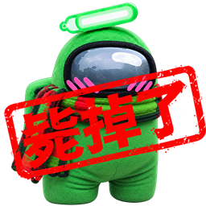

# Town of Host: Enhanced-Enhanced (TOHEE)

[English](README.md) | [简体中文](README.zh-CN.md)

A classic **Host Only** mod based on the stable **Town of Host: Enhanced v2.1.1** release, continuously improved with the help of Codex and updated to support the latest versions of Among Us.

Through this project, the developer is actively exploring the possibilities of AI-assisted development, with the goal of lowering the barrier to Among Us modding and enabling every player to participate in mod development with AI tools. We are committed to turning this vision into reality through continuous experimentation and practical development.

**Official Website:** https://tohee.niko233.top/

**Discord Community:** https://discord.gg/guf9ca4YSA

**QQ Group:** 975714136

## Why TOHEE?

- **The Authentic TOHE Experience:** Maintained by a former Lead Developer of TOHE, preserving the classic gameplay experience players know and love.
- **Player-Focused Development:** We prioritize the actual gameplay experience, continuously refining existing features and introducing practical improvements.
- **Lightweight, Stable, and Efficient:** Optimized resource usage and performance to minimize lag and crashes, providing a smooth gaming experience.
- **Comprehensive Cloud Services:** [TOHEE Cloud](https://tohee.niko233.top/) provides a highly available, free, user-friendly, and feature-rich platform, with more capabilities being developed.
- **Rapid Development:** Extensive use of AI in development enables faster implementation and bug fixes without compromising code quality and maintainability.
- **Official Server Compatibility:** Thanks to the developer's extensive research into the Among Us networking protocol, TOHEE supports playing on official Among Us servers.
- **Respect for Community Standards:** We strictly follow the Among Us Modding Policy and fulfill our obligations under the GPL-3.0 license.
- **Financial Transparency:** We currently have no donation channels, so there is no donation income to disclose.
- **A Developer You Can Trust:** Maintained by a developer whose prompting skills and sense of aesthetics are, fortunately, still intact.

## Contributing

We welcome everyone to contribute to the development and improvement of TOHEE, **regardless of whether you have previous experience developing Among Us mods**.

We believe that a successful community project depends not only on a handful of developers, but also on everyone willing to contribute their ideas, skills, and time.

### Art, Audio, and Video Contributions

If you wish to contribute artwork, audio, video, or other creative assets, please clearly identify their sources, copyright ownership, and whether you hold the necessary rights or permissions to contribute them.

If the assets involve third-party copyrights or are not entirely your own work, please ensure that you:

- **Verify Usage Rights:** Confirm that the assets can legally be used in this project before submitting them.
- **Respect Third-Party Rights:** Ensure that using, modifying, and distributing the assets will not infringe upon anyone else's rights.
- **Disclose Licensing Terms:** Clearly state the sources, copyright ownership, and applicable licensing conditions, including any attribution requirements or usage restrictions.

Please only submit assets that you are legally authorized to contribute and that this project can lawfully use and distribute, in order to avoid unnecessary copyright disputes.

### AI-Assisted Development

**We welcome and actively encourage contributions made with AI tools.**

You do not need extensive programming experience. However, you should have decent prompting skills, basic technical judgment, and a reasonable sense of what constitutes good code.

When submitting AI-assisted code, please follow these principles:

- **Define Clear Goals:** Understand what you want to achieve and why the change is necessary.
- **Explain Your Changes:** Clearly describe the expected behavior, implementation results, and potential impact on existing functionality.
- **Test Thoroughly:** Perform appropriate testing before submitting your changes to ensure that they work as intended and do not introduce obvious bugs or regressions.
- **Review AI-Generated Code:** Do not blindly accept AI-generated output. Understand its basic logic and evaluate whether the implementation makes sense.
- **Take Responsibility for Code Quality:** Whether the code was written manually or generated with AI assistance, the contributor remains responsible for its quality.

**AI is a development tool, not an excuse to avoid thinking, testing, or taking responsibility for code quality.**

We believe that successful AI-assisted development depends not only on the capabilities of the model, but also on the judgment, communication skills, and aesthetic sensibility of the person using it.

## Acknowledgements

TOHEE would not exist without the long-standing efforts of numerous open-source projects, developers, and community members.

We would like to express our sincere gratitude to everyone who has contributed to the Among Us modding ecosystem.

The acknowledgements below are arranged according to the logical structure chosen when writing this document. **Their order does not reflect the importance, significance, or relative value of anyone's contributions.**

### Innersloth

Innersloth develops and continues to operate Among Us, providing the foundation and essential support upon which the game and its modding community exist.

Although some of their decisions have had mixed effects on the development of the modding community, we nevertheless appreciate Innersloth's contributions to Among Us and its community.

### BepInEx

BepInEx is an essential modding framework that provides fundamental technical support for developing and running Among Us mods.

We sincerely thank all BepInEx contributors for their work.

### Town of Host

Town of Host was one of the pioneering Host Only mods, laying the groundwork for many projects that followed.

Town of Host Edited was developed based on Town of Host.

We extend our gratitude to all contributors to Town of Host.

### Town of Host Edited

Town of Host Edited was an important project in the history of Host Only mods and one of the most notable mods of its time.

Town of Host: Re-Edited was developed based on Town of Host Edited.

We sincerely thank all contributors to Town of Host Edited.

### Town of Host: Re-Edited

Town of Host: Enhanced was developed based on Town of Host: Re-Edited.

Although the evolution and transition between these projects involved some controversy, that does not diminish the value of the contributions made by their developers.

We extend our sincere appreciation to everyone who contributed to Town of Host: Re-Edited.

### Town of Host: Enhanced

**Town of Host: Enhanced is the direct upstream project of TOHEE.**

Many talented developers devoted substantial time and effort to this classic mod, bringing a wide range of gameplay content and continuous technical improvements.

TOHEE continues to maintain, improve, and build upon its stable release.

We are deeply grateful to everyone who participated in the development, maintenance, and community-driven evolution of Town of Host: Enhanced.

### Endless Host Roles

Endless Host Roles (EHR) is a fork of Town of Host: Re-Edited.

Through the continued efforts of its contributors, EHR has become one of the most popular Host Only mods in the Among Us modding community.

Town of Host: Enhanced adopted some of EHR's role designs and game modes and incorporated portions of its code. The contributions are too numerous to list individually here.

Additionally, **TOHEE Cloud was developed with reference to the cloud service created by the Endless Host Roles developers**, which provided valuable design inspiration and functional references for our own cloud platform.

We sincerely thank the developers and all contributors to Endless Host Roles for their work.

### Project: Lotus

Project: Lotus is another widely recognized Host Only mod in the current Among Us modding community.

Town of Host: Enhanced drew inspiration from some of its role designs.

We extend our gratitude to all contributors to Project: Lotus.

### More Game Modes

The developer of More Game Modes was arguably one of the most knowledgeable Among Us modders of their time, particularly regarding the game's networking protocol and internal mechanics.

Their pioneering work on mechanisms such as **Role Override** and **Custom Net Objects** had a profound impact on the development of Host Only mods. These concepts continue to be widely used across numerous projects today.

Town of Host: Enhanced incorporated some of its code and design concepts.

We sincerely thank the developer and all contributors to More Game Modes for their outstanding contributions.

### Town Of Host_Y

Town of Host: Enhanced incorporated some role designs and code from this project.

Due to the considerable time that has passed, we can no longer accurately or comprehensively trace every individual contribution.

Nevertheless, we sincerely thank its developers and contributors.

### Town Of Host: The Other Roles

Town of Host: Enhanced incorporated some role designs and code from this project.

Due to the considerable time that has passed, we can no longer accurately or comprehensively trace every individual contribution.

Nevertheless, we sincerely thank its developers and contributors.

### TownOfPlus

Town of Host: Enhanced incorporated some role designs and code from this project.

Due to the considerable time that has passed, we can no longer accurately or comprehensively trace every individual contribution.

Nevertheless, we sincerely thank its developers and contributors.

### RevolutionaryHostRoles

Town of Host: Enhanced incorporated some role designs and code from this project.

Due to the considerable time that has passed, we can no longer accurately or comprehensively trace every individual contribution.

Nevertheless, we sincerely thank its developers and contributors.

### TownOfNewEpic_Xtreme

TownOfNewEpic_Xtreme was a successor to Town of Host Edited.

When Innersloth introduced server-side authorization for player kills (`MurderPlayer`), causing breaking changes that disrupted numerous Host Only mods, TownOfNewEpic_Xtreme was among the few Host Only mods that remained playable.

It provided valuable support to the player community during that period.

Town of Host: Enhanced incorporated some of its role designs and code.

Due to the considerable time that has passed, we can no longer accurately or comprehensively trace every individual contribution.

Nevertheless, we sincerely thank its developers and contributors.

### Stellar Roles

Town of Host: Enhanced drew inspiration from some of the role designs in Stellar Roles.

Due to the considerable time that has passed, we can no longer accurately or comprehensively trace every individual contribution.

Nevertheless, we sincerely thank its developers and contributors.

### Town of Us-R

Town of Host: Enhanced incorporated portions of the code from Town of Us-R.

Due to the considerable time that has passed, we can no longer accurately or comprehensively trace every individual contribution.

Nevertheless, we sincerely thank its developers and contributors.

### Super New Roles

Town of Host: Enhanced incorporated portions of the code from Super New Roles.

Due to the considerable time that has passed, we can no longer accurately or comprehensively trace every individual contribution.

Nevertheless, we sincerely thank its developers and contributors.

### Mini.RegionInstall

Unbelievable! We integrated Mini.RegionInstall directly into the mod, and even today, we are still using it to install and manage custom servers.

This incredibly useful little tool has truly stood the test of time.

Our sincere thanks go to the developer of Mini.RegionInstall.

### Overloaded & Crowded Mod

Overloaded is a fork of Crowded Mod.

These two mods brought support for **lobbies with more than 15 players** to Among Us, overcoming the original player-count limitations and laying important technical groundwork for larger lobbies.

TOHEE includes functionality from Overloaded.

We sincerely thank all contributors to Overloaded and Crowded Mod.

### Modded Among Us Lobbies

Modded Among Us Lobbies is currently the largest Among Us modding community Discord server, providing an important platform for communication and collaboration among modded Among Us players, developers, and project maintainers.

The community's **Owner and Staff have provided tremendous assistance throughout the development and maintenance of this project**. Their longstanding dedication has also made an outstanding and significant contribution to the growth of the wider Among Us modding community.

We extend our heartfelt gratitude to everyone involved in managing and operating Modded Among Us Lobbies, both for their invaluable support of our project and for their continued efforts to help the entire modding community thrive.

### To All Contributors

The Among Us modding community has been shaped by the dedication and creativity of countless developers, artists, asset creators, and community members.

Given the long history of these projects and the wide range of contributions involved, we have unfortunately been unable to identify and individually acknowledge every developer, asset creator, and contributor whose work has directly or indirectly benefited TOHEE and its upstream projects.

**Not being mentioned by name does not mean that your contributions have been forgotten or overlooked.**

We extend our sincere gratitude to everyone who has contributed, directly or indirectly, to this project.

It is through your collective efforts that these wonderful projects have been created, preserved, and carried forward to this day.

### To All Players

Finally, we would like to express our heartfelt gratitude to every player who has supported and accompanied Town of Host: Enhanced and TOHEE throughout the years.

Thank you for your continued trust, support, and companionship. Thank you for the countless joyful moments you have created in the game, and thank you to everyone who has reported bugs, shared suggestions, participated in testing, or helped improve the mod.

Whether you are a longtime player who has been with us through countless versions or a newcomer who has just joined the community, your enthusiasm and support have always been among the most important reasons this project continues to exist and evolve.

**Games are made special by their players, and mods live on through their communities.**

Thank you for being part of this journey.

We hope TOHEE will continue to bring you the familiar and wonderful gameplay experiences you remember, and that the joy we share as part of the Among Us community will live on for many years to come.